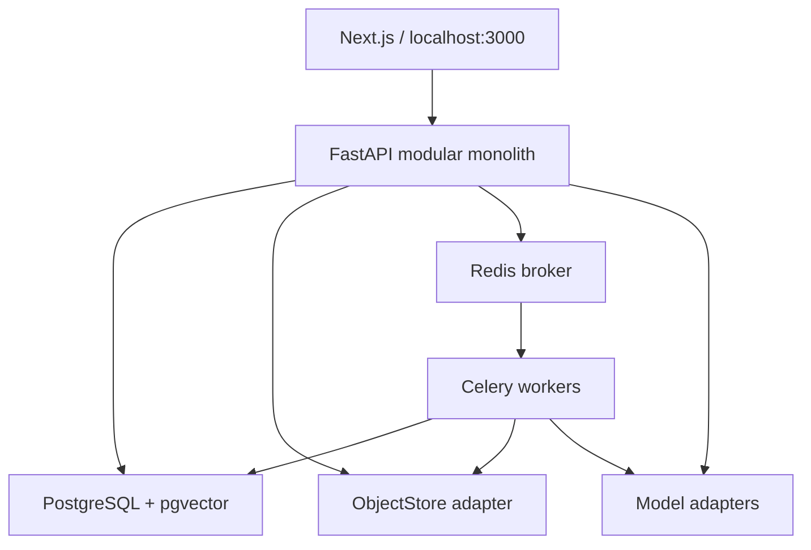

# 03 · Kiến trúc và ranh giới module

## Phạm vi hiện hành — ADR-21

Windows là máy dev; Ubuntu 22.04 chạy OCR/storage/retrieval cùng host với Gemma
llama.cpp đã có. Topology bên dưới là đích dài hạn. Compose hiện chỉ triển khai
PostgreSQL, Redis và `corpus-inspect` chạy một lần; không tham chiếu module chưa có.
Image mang code, sách mount read-only, DB/objects/checkpoints ngoài Git.

Ưu tiên library → jobs → review → search/evaluation; calculation/DSL/chat sau.
Kế hoạch corpus hiện hành ở docs/07. Gemma ngoài Compose dự án,
provider `openai_compatible`; OCR không dùng LLM sửa chữ âm thầm, mọi đề xuất là
draft cần nguồn và reviewer. Không thay business schema/REST contracts.

## Topology

Một repository, một backend package, migrations dùng chung. API process không chạy OCR/model nặng. Worker profiles `ingest`, `ocr`, `ai`, `maintenance`; không tách network service nghiệp vụ. Reverse proxy Caddy/Nginx tại một cổng loopback: `/api/*` đến FastAPI, còn lại Next.js; SSE tắt buffering. Database/Redis/object volume không expose host port mặc định. Dev override được bind loopback riêng, không `0.0.0.0`.

## Stack chốt và điều chỉnh

Python 3.12 làm baseline tương thích; PostgreSQL 17 + pgvector từ 0.8 để có iterative scans; FastAPI/Pydantic2/SQLAlchemy2/Alembic; Next.js + TypeScript; Redis + Celery. Đây là baseline để giải compatibility ở T002, không chỉ định “latest” hoặc cam kết một patch chưa test. Lock tất cả transitive dependencies, image digest và model revision sau smoke.

Storage: `ObjectStore` interface với `put_if_absent`, `get_stream`, `stat`, `delete`, `list_manifest`, `copy_verified`; local filesystem volume là mặc định, S3-compatible adapter cùng contract. Blob key do server tạo theo hash/UUID, không nhận path từ client. MinIO Community không là dependency bắt buộc (ADR-03). Tài liệu lớn được stream, không load nguyên sách vào RAM.

PyMuPDF dùng cho audit hiện tại và là parser option khi giấy phép cho phép; implementation default dùng Docling native pipeline + backend parser được kiểm tra license ở T002. PyMuPDF adapter là optional profile; không coi tách process là cách né nghĩa vụ license. OCRmyPDF/Tesseract là worker option cho scanned PDF; Tesseract vùng ảnh hỗ trợ `vie+eng`, thêm `chi_sim/chi_tra` nếu nguồn cần. Reranker/embedding model có registry, không hardcode provider trong code.

## Module contracts nội bộ

| Module | Sở hữu | Đầu vào → đầu ra | Không được làm |
|---|---|---|---|
| auth/settings | users, session, permissions, runtime profiles | principal → policy/secret reference | Trả secret về browser |
| storage | immutable blobs, checksums | stream → object id | Dùng tên upload làm đường dẫn |
| documents | books, versions, pages, corrections | object → versioned source | Duyệt rule tự động |
| ingestion | job/stage/lease/outbox/publication | version+pipeline → snapshot | Ghi đè nguồn đang được citation dùng |
| knowledge/cases | concepts, assertions, rules, evidence, review | candidates → approved revisions | Đồng nhất school không có duyệt |
| retrieval | lexical/vector/rerank/context | QuerySpec → EvidenceBundle | Tự sinh trang nguồn |
| calculation | time/calendar/pillars/cycles | BirthInput+policy → ChartFacts | Gọi LLM |
| rules | DSL validation, DAG, tri-valued evaluation | facts+ruleset → RuleTrace | eval/exec/Python dynamic |
| reasoning/chat | run orchestration, claims, sessions, cost | context+facts+evidence → Answer | Sửa facts hoặc publish tri thức |
| evaluation/operations | datasets, runs, reports, backups | scenario → measured results | Tự chấm thay chuyên gia |

## Transaction và event

API mutation ghi DB + `outbox_events` trong cùng transaction, sau đó dispatcher đẩy Celery. Worker lock job stage/page, nhận lease có fencing token, ghi output vào staging key, kiểm tra token còn hiện hành trước commit. Outbox có event_id unique; consumer dedupe bằng `processed_events`. Không giả định delivery exactly-once. Watchdog tìm lease hết hạn và requeue từ checkpoint; Redis restart không làm mất danh sách job cần chạy.

Khởi tạo kho trống không cần tạo fake release/model vectors: chưa có row active_corpus thì search trả empty_corpus, chat run corpus_release_id=null; tables, ontology taxonomy và chart vẫn dùng được. Embedding profile mặc định được cài ở task indexing; model bytes tải theo cấu hình, không bắt buộc để mở UI.

Đọc snapshot: một `corpus_release` ghim mapping version→generation; release có lifecycle BUILDING/READY/ACTIVE/RETIRED. Active pointer chuyển trong một transaction sau khi tất cả membership và index sẵn sàng. Truy vấn lọc release_id. OCR correction tạo revision mới, generation mới, chunks mới trong cửa sổ ảnh hưởng; phần không đổi tái dùng revision/chunk IDs qua membership. Không ghép text mới với embedding cũ.

Hai mức version tách biệt: (1) ingest generation của một book version; (2) corpus release chứa nhiều generation. Rule set và ontology revision độc lập với corpus release; chat run ghi cả ba. Chuyển embedding profile xây release mới đầy đủ; query vector và stored vectors phải cùng profile/model dimension. Không trộn vector khác model dù cùng số chiều.

## Dữ liệu cá nhân và chi phí

Chart computation local. API provider chỉ nhận facts đã bỏ tên/định danh và đoạn nguồn được phép; sách mặc định `external_processing_allowed=false` đến khi admin lựa chọn trong upload policy. LLM giới hạn token, timeout, retry, budget reservation, không gửi cả sách cho mỗi câu hỏi. Retry provider có thể vẫn tính phí; log estimate và actual riêng.

## Quy mô trên máy cá nhân

Khởi đầu CPU OCR concurrency=1, ingest=2, prefetch=1 cho long jobs; embedding batching theo token budget. Đây là tham số ban đầu để benchmark, không hứa throughput. Máy RAM 32 GB có thể phân bổ thử 12–16 GB cho Docker, còn lại cho Windows/IDE; `doctor` đọc tài nguyên thực tế thay vì mặc định cấu hình này có sẵn. GPU không bắt buộc. PDF 100–500 nghìn trang chạy theo queue và disk budget, không xử lý tất cả trong một transaction. Chính sách pause khi disk dưới ngưỡng (mặc định 15% hoặc 10 GiB, lấy giá trị lớn hơn) và resume sau khi đủ dung lượng.
